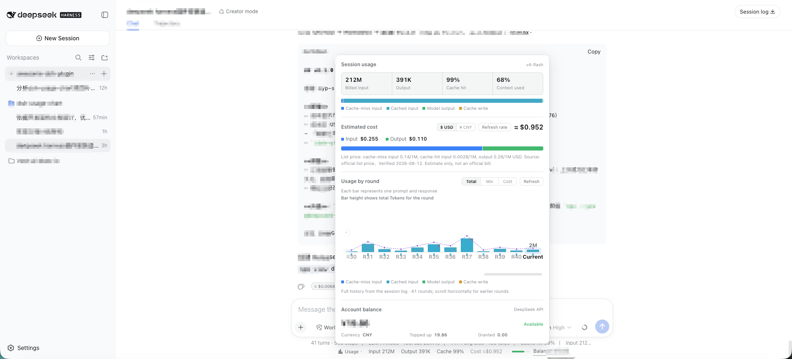
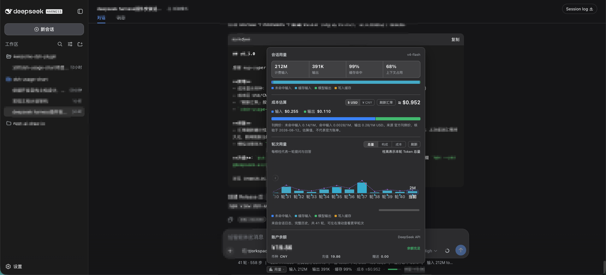

# dsh-usage-chart

> A usage, cost, and account-balance dashboard for DeepSeek Harness Web.

[](https://www.npmjs.com/package/dsh-usage-chart)
[](https://github.com/Max-Samson/dsh-usage-chart/actions)
[](./LICENSE)

[简体中文](./README_ZH.md) · [Report an issue](https://github.com/Max-Samson/dsh-usage-chart/issues) · [Changelog (EN)](./CHANGELOG.md) · [更新日志（中文）](./CHANGELOG_ZH.md)

Interface preview: light English on the left and dark Simplified Chinese on the right. Both variants follow the DSH theme and in-app language setting.

<table>
  <tr>
    <td width="50%"><br /><sub>Light theme · English</sub></td>
    <td width="50%"><br /><sub>Dark theme · 简体中文</sub></td>
  </tr>
</table>

> Both screenshots use fictional demo data only. They contain no real session content, token counts, costs, balances, or API keys.

The plugin adds a compact indicator below the conversation composer. It shows input/output tokens, cache-hit ratio, estimated cost, active model, a multi-segment context-pressure bar (system/tools/messages breakdown, v1.1.0), and DeepSeek account balance. Click it to open a zero-dependency SVG dashboard with per-turn usage history — including a cost view (every bar shows its own cost value, not just the current round), a duration overlay, anomaly markers, an explainer tooltip (tokens + cost + model + billing tier + duration/TTFT/TPS + **user input source attribution: human/agent/continuation**, v1.1.0 + end reason), horizontally scrollable per-round bars (all rounds, fixed slim bar width, auto-scroll to latest), a dedicated **Context & Compaction Diagnostics section** (system/tools/messages token composition, compaction timeline, freed tokens, summarize cost, context occupancy suggestions, v1.1.0), a dismissible `≈ ¥/$0.00xx` badge on each assistant message, peak/off-peak tiered billing with a live red/green billing-tier tag in the panel (red = peak, green = off-peak, v1.0.1), and official dual-currency pricing (native CNY/USD quotes are preserved) and a shared display FX rate for single-currency quotes.

```
▸ Input 12.4M · Output 86.2K · Hit 72% · Cost ≈$0.042 / ≈¥0.284 · demo-model · Balance --
```

Click ▸ to open the dashboard panel:

- **Session usage summary** — Input (uncached/cached), output, cache-hit percentage, and context occupancy (derived from official adapter `tokenUsage` / `contextPressure` projections).
- **Context breakdown & compaction diagnostics (v1.1.0)** — Official `contextBreakdown` projection breakdown (System prompt / Tools schema / Message history token counts and percentage with a 3-segment color bar, annotated as heuristic approximations); Host folds `compaction/*` events (which round was compacted, how many tokens were freed, model used, and summarize call cost); provides proactive suggestions (≥75% / ≥90% occupancy) to start a new session or reduce large file injections.
- **Cost estimation** — Estimated from official list prices (CNY/USD dual-currency per 1M tokens, peak/off-peak tiers) with verified source date; supports user override via `pricing.json`; built-in Anthropic Claude official API standard rates (USD); unpriced models are explicitly tagged.
- **Session-cost aggregation (v1.1.7)** — Adds the host's per-round costs using each round's model and billing tier. While a new round is in progress, the indicator and panel share the fetched history plus a marked estimate for new tokens, then refresh the history after token updates pause. The model label follows the same current-history/live-node priority in both places.
- **DSH 0.1.2+ and themed docks (v1.1.7)** — Reads conversation nodes from the independent `chat` source on newer DSH versions, with a legacy session-snapshot fallback; keeps the expanded panel anchored when a theme creates a fixed-position containing block.
- **DSH 0.2.x client-SDK compatibility (v1.1.8)** — Declares client peer ranges spanning both DSH 0.1.x and 0.2.x (tested against 0.2.1-rc.2) so DSH 0.2.x's plugin admission gate accepts the plugin at startup; the retired `@deepseek-ai/dsh-client-runtime` peer is gone, and the assistant-node model identity now also reads the 0.2.x `providerMetadata` field (0.1.x `provenance` still preferred when present, `requestConfig` kept as the last fallback).
- **Peak / off-peak tiered billing (v1.0.1)** — Peak hours (Beijing time Monday–Friday 09:00–12:00 and 14:00–18:00, UTC 01:00–04:00 and 06:00–10:00) billed at 2× the off-peak rate; all other hours and weekends billed at off-peak rates; rounds bill automatically based on start time (or conservative peak if unknown); live red/green tag in the panel header.
- **Official dual-currency list pricing (v1.0.1)** — Native CNY and USD quotes are preserved. Single-currency quotes (including Claude and user overrides) use one shared display FX rate across history, live estimates, charts and badges.
- **Multi-currency display (v0.3 / v1.0.1)** — One-click toggle between USD and CNY (persisted in localStorage); indicator, panel, chart, and badges all follow.
- **Per-round usage & source attribution (v1.1.0)** — "Total / Composition / **Cost**" view modes; cost mode shows each bar's monetary amount; duration line overlay; anomaly marker chips on cost spikes; cache hit miniature ticks; hover explainer card with full round metrics + **user input source attribution: human/agent/continuation**; horizontal scroll for full session history.
- **Cost badge** — Dismissible `≈ ¥/$0.00xx` badge rendered at the bottom of each assistant message.
- **Multi-segment context pressure bar (v1.1.0)** — Slim bar in the composer dock indicating total context occupancy from green to red, segmented by System (blue), Tools (amber), and Messages (green) with hover percentages.
- **Account balance** — Real-time balance queried via official DeepSeek API (proxied securely through Host, API key never exposed to browser).
- **Bilingual (ZH / EN)** — Automatically follows DSH in-app language setting, with runtime switching between `zh` and `en`.

## Data sources

| Metric | Source | Accuracy |
|---|---|---|
| Token usage | DSH official adapter session projections (`tokenUsage` / `contextPressure`) | ✅ Official real-time data |
| Cost | Official list price (builtin + optional `pricing.json` override, CNY/USD dual-currency / 1M tokens, peak/off-peak tiers) × reported usage | ⚠️ Estimate, not invoice; resolved via Host `/pricing` snapshot |
| Display currency | Host `/meta` config; costs directly calculated in selected currency list price | ✅ Official dual-currency list price |
| Per-round history | Host session log fold (`/usage`): duration / TTFT / TPS / model attribution / **input source attribution** / end reason / per-round cost. DSH 0.2.x counts `assistant/message` and failed `assistant/attempt` usage (including stream-only samples); TTFT uses the first token-bearing fragment, and TPS uses summed per-attempt generation time; 0.1.x keeps chunk/usage anchors | ✅ Official event stream fold |
| Context & compaction | Official `contextBreakdown` / `contextPressure` projections + Host `compaction/*` event fold | ✅ Official projections + event fold |
| Balance | Official `GET https://api.deepseek.com/user/balance` | ✅ Official real-time data |
| Model name | Host history: `request/context` → `request/header` → last model; live nodes: `provenance` (0.1.x) → `providerMetadata` (0.2.x) → `requestConfig` | ✅ Official real-time data |

## Tech stack

- **Language**: TypeScript source, compiled to DSH loadable JavaScript bundles
- **Framework**: [Cordis](https://github.com/cordiverse/cordis) plugin model + React 18
- **Build**: esbuild (Host half = Node ESM; Client half = browser factory bundle matching DSH Web `PLATFORM_MODULES`)
- **Visualization**: Zero-dependency handcrafted SVG (matches platform rendering, minimal footprint, ultra-stable)

## v1.1.9 — Claude pricing and consistent cost valuation

**v1.1.9** includes the Claude standard-price catalog, separate cache-write rates, safer model-id matching and explicit unpriced-round handling, plus consistent Host/Client override priority, complete cost breakdowns and shared FX valuation. All single-currency quotes use one display rate; explicit dual-currency prices remain unchanged. See [v1.1.9 changes and upgrade notes](./CHANGELOG.md).

The source version is not proof of npm publication. Run `npm view dsh-usage-chart@1.1.9 version` before using the version-pinned upgrade command below. After upgrading, restart `dsh web` and reload the browser; no session-data migration is required.

## Install

Prerequisites: **[DeepSeek Harness](https://github.com/deepseek-ai/deepseek-harness) ≥ 0.1.0-rc.6** · **Node.js ≥ 20** · **[pnpm](https://pnpm.io/install) on PATH** (`dsh plugin` forwards installs to pnpm).

> If you get `dsh: command not found` (or PowerShell `The term 'dsh' is not recognized…`),
> you ran `npx @deepseek-ai/dsh` transiently — see FAQ item 1 (install globally, or prefix commands with `npx --yes @deepseek-ai/dsh`).

### Option 1: npm registry (recommended, prebuilt — no build tooling needed)

```sh
dsh plugin --profile web add dsh-usage-chart   # installs and registers the profile plugin layer
dsh web --profile web                          # starts DSH Web (stop it first if already running)
```

To update after **v1.1.9** is published: pnpm may print `Already up to date` when already installed — use an **explicit version** (recommended) or **remove then re-add**:

```sh
# Option ①: pin the target version explicitly
dsh plugin --profile web add dsh-usage-chart@1.1.9
# Option ②: remove, then re-add (back to latest)
dsh plugin --profile web remove dsh-usage-chart
dsh plugin --profile web add dsh-usage-chart
```

Then restart DSH Web.

> ⚠️ **Restarting the `dsh web` process is required after any upgrade.** The Host caches plugin code in memory (no hot reload): new routes (e.g. `/pricing`, `/meta`, `/rate`) are only served after a restart. See the [Changelog](./CHANGELOG.md).

### Option 2: install from GitHub (source build)

```sh
dsh plugin --profile web add github:Max-Samson/dsh-usage-chart#<commit-sha>
```

Git installs run the package `prepare` script (`node build.mjs`) to build from source. pnpm ≥ 10 blocks `prepare` scripts by default — allow this package in the profile's `pnpm-workspace.yaml`, then re-run:

```yaml
allowBuilds:
  dsh-usage-chart: true
```

### Option 3: local directory (development)

```sh
git clone https://github.com/Max-Samson/dsh-usage-chart.git
cd dsh-usage-chart
npm ci && npm run build
dsh plugin --profile web add "$PWD"   # links the current checkout
dsh web --profile web
```

### Verify the install

1. The composed profile should contain the plugin row:

   ```sh
   dsh --profile web --dump-config | grep -A4 'id: dsh-usage-chart'
   ```

2. Open DSH Web and enter any existing session: the "Usage" indicator (tokens / cost / model) appears below the composer, with the account balance on the right; click ▸ to open the dashboard.

### Balance query configuration

The balance query needs a DeepSeek API key, resolved per request in this order (no restart needed):

1. **DSH Web settings (recommended, requires plugin ≥ 0.1.1)**: configure the DeepSeek API key under Settings → Models. The plugin reads the same key through the DSH credentials service (`.credentials.yaml` user layer); no extra setup is required.
2. **Environment variable**: `DEEPSEEK_API_KEY=sk-...` before starting `dsh web` (the credentials service's `env` layer resolves it the same way).
3. **Plugin config**: override `config.apiKey` in the profile's `cordis.patch.yml` (stored in plain text on disk — only recommended for a protected local profile):

```yaml
- insert:
    - id: dsh-usage-chart
      name: dsh-usage-chart
      config:
        apiKey: 'sk-...'        # empty falls back to web settings / env variable
        baseUrl: 'https://api.deepseek.com'
        # pricingFile: '/path/to/pricing.json'   # optional: price override file
        # currency: 'cny'        # optional (v0.3): 'usd' (default) | 'cny'
        # cnyPerUsd: 6.76        # optional: shared display FX rate for single-currency quotes
        # fxUrl: 'https://open.er-api.com/v6/latest/USD'   # optional (v0.3): custom live rate source
```

The key stays in the Host process and is never sent to the browser.

### Price overrides (optional, v0.2+ / v1.0.1 dual-currency, tiered)

Costs are resolved with priority **user override file > builtin list price > fallback estimate** (prices are resolved only on the Host; the client consumes the `/dsh-usage-chart/pricing` snapshot — a single source of truth, ADR 2). The default override file is `$DSH_HOME/data/dsh-usage-chart/pricing.json` (or `~/.dsh/...` without `DSH_HOME`); both flat and `{ "models": { … } }` shapes are accepted and changes are picked up live:

```json
{
  "deepseek-flash": {
    "offPeak": {
      "cny": { "cacheMissInput": 1, "cacheHitInput": 0.02, "output": 4 },
      "usd": { "cacheMissInput": 0.15, "cacheHitInput": 0.003, "output": 0.6 }
    },
    "peak": {
      "cny": { "cacheMissInput": 2, "cacheHitInput": 0.04, "output": 8 },
      "usd": { "cacheMissInput": 0.3, "cacheHitInput": 0.006, "output": 1.2 }
    },
    "verifiedAt": 1788998400000
  }
}
```

Unit prices are **dual-currency (CNY + USD) per 1M tokens**: `peak` covers peak hours (Beijing time Monday–Friday 09:00–12:00 and 14:00–18:00, charged at 2×), `offPeak` covers the rest (including weekends). Prices may also carry an optional `cacheWrite` (cache-write rate); when omitted, cache writes are billed at the cache-miss rate.

**Models that are not listed** are explicitly marked "Unpriced model" in the UI:

- DeepSeek models (and a missing model name) are **estimated** at the `deepseek-flash` list price, shown with `≈`;
- models whose id contains `claude` (including Bedrock ids such as `anthropic.claude-…` and display names such as `Claude Opus 5.5`) are **not estimated**: their rates are zero and their cost is excluded, so they are never billed at DeepSeek rates (which would understate them by tens of times). A session total that includes such rounds is shown as `≥` (a lower bound) with a note in the panel; the cost badge and compaction cost do not show `$0`, and anomaly detection skips these rounds.

#### Claude models

Built-in standard rates from the [Anthropic pricing page](https://platform.claude.com/docs/en/about-claude/pricing) (USD per 1M tokens, verified 2026-11-05) cover Fable 5.1 / 5, Mythos 5.1 / 5, Opus 5.5 / 5 / 4.8 / 4.7 / 4.6 / 4.5 / 4.1 / 4, Sonnet 5.5 / 5 / 4.6 / 4.5 / 4 and Haiku 4.5:

- No peak/off-peak tiers; cache writes use the 5-minute TTL rate (usage cannot distinguish 1-hour TTL writes);
- Model-id matching normalizes the `anthropic/` prefix and dotted versions (`claude-opus-5.5`); ids with a dated snapshot suffix (`-20261101` / `-latest`) are priced as that model; any other variant (an unlisted newer version, `-fast`, `-batch`, Bedrock ids, …) is treated as unpriced and never borrows a similar model's rate;
- **Claude Haiku 5.5 is not listed yet**: it is priced by per-request prompt length (≤100K / >100K), which a per-round total cannot determine;
- Not included: batch discounts, regional / `inference_geo` premiums, Fast mode, tool fees;
- Anthropic only quotes USD; CNY amounts use the **shared display FX rate**, including `cnyPerUsd`, the saved last successful rate and manually refreshed rates, just like every user single-currency quote.

### Display currency and live FX rate (v0.3+ / v1.0.1 official dual-currency)

The **CNY/USD** toggle is remembered in the browser. The indicator, panel, charts, compaction costs and message badges share one valuation policy:

- **Explicit dual-currency quotes**: keep DeepSeek's native CNY/USD prices and any user-supplied pair unchanged; do not overwrite native quotes with FX conversion.
- **Single-currency quotes**: builtin Claude (USD), user `usd`-only or `cny`-only entries and legacy flat CNY entries all use the same `pricingAtRate` function to derive the other currency, including cache-write prices.
- **One FX source**: start with `config.cnyPerUsd` from `/meta` (invalid/missing values default to 6.76), prefer the browser's saved last successful rate when available, then update and save it on manual refresh through Host `/rate`. The primary source is `config.fxUrl` or open.er-api.com, with frankfurter.dev as fallback. Failed refreshes keep the last successful value.
- **History after refresh**: `/usage?session=…&cnyPerUsd=…` receives the current display rate and recalculates rounds and compactions; live increments and unit-price notes use that same rate. Requests are deduplicated by session plus rate; stale responses cannot replace another session or rate.
- **Estimates, not invoices**: historical costs are revalued at the current display rate, not the FX rate at request time. Session logs are never changed. Native dual-currency quotes do not change on refresh.
- **Complete breakdown**: input (cache miss plus cache write), cache read and output appear in both the cost breakdown and composition bar. They sum to the total; a separate cache-write rate is explained in the panel when present.

Single-currency override example (per 1M tokens, flat across both tiers):

```json
{
  "my-usd-model": {
    "usd": { "cacheMissInput": 4, "cacheHitInput": 0.2, "output": 20, "cacheWrite": 5 }
  }
}
```

Host and client use the same source priority: **user file → builtin → unknown-model handling**. Within each source, exact matching wins, then the longest eligible prefix. A user-file prefix override therefore also wins over a builtin exact key.

### Uninstall

```sh
dsh plugin --profile web remove dsh-usage-chart   # removes the dependency and de-registers the layer
dsh web --profile web                             # restart; indicator and panel disappear
```

`remove` also cleans the package out of `node_modules` and `dsh.profile.bundles` (no leftovers).

## FAQ

**Q: `dsh` is not found (`command not found` / PowerShell `The term 'dsh' is not recognized`)?**
A: `npx @deepseek-ai/dsh` runs transiently and installs no global command. Run `npm install -g @deepseek-ai/dsh` and open a new terminal, or prefix commands with `npx --yes @deepseek-ai/dsh ...`. Missing pnpm is the same: `npm install -g pnpm`.

**Q: Install shows `WARN missing peer react@^18.2.0`?**
A: Harmless — react is provided by the DSH Web platform in the browser; the profile does not need it. Plugin ≥ 0.1.1 marks react as an optional peer.

**Q: DSH 0.2.x warns `dsh-usage-chart@1.1.7 与 DSH 0.2.1-rc.2 不兼容（要求 @deepseek-ai/dsh-client-locale >=0.1.0-rc.6 <0.2.0, ...）…` — is the plugin incompatible?**
A: That warning comes from DSH 0.2.x's **plugin admission gate**, not from a damaged DSH install and not from data loss: DSH refuses to load a plugin whose `@deepseek-ai/dsh*` peer ranges do not match the running runtime version, and plugin versions through 1.1.7 declared 0.1.x-only ranges. Upgrade the plugin to **≥ 1.1.8** (`dsh plugin --profile web add dsh-usage-chart@1.1.9`), then restart `dsh web` and reload the DSH Web page if it was already open. DSH itself was not damaged and no session data, costs, or credentials were lost — the plugin simply was not loaded.

**Q: The balance still shows `–` / "not configured" after setting the API key in the web UI?**
A: Make sure the plugin is ≥ 0.1.1, then restart `dsh web`. As a stopgap, set `DEEPSEEK_API_KEY` or `config.apiKey`.

**Q: `add` reports `dsh-usage-chart is not in the npm registry`?**
A: Check the package name, requested version, and registry connectivity. A version in Git is not necessarily published to npm: use `npm view dsh-usage-chart version` to check the current release and `npm view dsh-usage-chart@<version> version` to check a specific version. For unreleased source, use "Option 3: local directory" and rebuild before testing.

## Development

```sh
git clone https://github.com/Max-Samson/dsh-usage-chart.git
cd dsh-usage-chart
npm ci
npm run verify       # typecheck + build + node:test
npm pack --dry-run   # check package tarball
```

### Visual probe scripts (optional)

`scripts/` provides playwright-core based probes targeting a running DSH Web instance (`http://127.0.0.1:3080` by default):

| Variable | Default | Purpose |
|---|---|---|
| `DSH_PROBE_URL` | `http://127.0.0.1:3080` | Target DSH Web URL |
| `DSH_PROBE_CHROME` | Platform default | Path to Chrome/Chromium executable |
| `DSH_PROBE_SESSION` | Builtin list | Target session title fragment |
| `DSH_PROBE_ARTIFACTS` | `<repo>/artifacts` | Screenshot output directory |

```sh
node scripts/shot.mjs          # Take collapsed/expanded screenshots
node scripts/probe-panel.mjs   # Test panel container clipping
node scripts/probe-popover.mjs # Test popover bounds and toggle
node scripts/verify-render.mjs # Full render verification (light/dark themes, ZH/EN)
```

## Maintainer releases

The version is **1.1.9** and its content is finalized. The maintainer chooses when to publish it; a source version or dated changelog is not proof that npm already has the package. Use **one** publication path, not both at once.

### Manual npm publication (this release)

The release content is on `fix/pricing-currency-consistency`, not yet on `main`. In your own checkout, with a clean working tree:

```sh
git fetch origin
git switch fix/pricing-currency-consistency
git pull --ff-only origin fix/pricing-currency-consistency
git status --short                       # must be clean
node -p "require('./package.json').version"  # must print 1.1.9
npm ci
npm run verify
npm pack --dry-run
npm view dsh-usage-chart versions --json   # confirm 1.1.9 is not already published
# Maintainer only: after reviewing the checks above
npm publish --access public
npm view dsh-usage-chart@1.1.9 version     # must print 1.1.9 after publication
```

Stop if the worktree/version is unexpected or npm already has 1.1.9; do not change versions or overwrite existing packages automatically. The `prepublishOnly` hook reruns verification and `prepare` rebuilds ignored `lib/` output. Inspect packaged runtime/type entries and README images; do not upload an old tarball or build from the earlier implementation commit. The maintainer handles npm sign-in and any 2FA prompts directly—never paste credentials into chat.

Both changelogs use the version-record date **2026-11-10 (Asia/Shanghai)**. If publication occurs on a different day, update both before publishing. Record supported-runtime clean-profile tests separately; unit tests or the isolated synthetic-Host browser probe do not certify installation. Users must restart `dsh web` and reload the browser after upgrading. No session-data migration is required.

### Optional GitHub Release workflow

The existing `release.yml` can publish via npm Trusted Publishing on a GitHub Release `published`/`edited` event or manual workflow dispatch. Therefore **do not publish a GitHub Release first when you intend to publish npm manually**. Do not change credentials or publisher settings to follow this guide. If using the workflow instead, tag the final verified release commit and wait for its CI before publishing the Release. After a manual npm publication, a later Release workflow skips the version already present on npm. A branch push or merge by itself does not publish npm.

## Plugin architecture

```
dsh-usage-chart/
├── package.json          # dsh.bundle (install layer) + dsh.client (browser half) + exports["./client"]
├── cordis.patch.yml      # Plugin insertion config (config.apiKey / baseUrl / pricingFile / currency…)
├── build.mjs             # esbuild dual outputs (+ client pure test bundle) + tsc type defs (lib/types)
├── src/
│   ├── index.ts          # Host half: /balance proxy + /usage round fold + /pricing snapshot
│   │                     #          + /meta currency config + /rate live FX proxy
│   ├── pricing/
│   │   ├── calc.ts       # Pure shared pricing math (dual-currency, peak/off-peak)
│   │   ├── source.ts     # PricingSource seam: builtin list prices + pricing.json file adapter
│   │   └── resolve.ts    # PricingResolver: user file > builtin > fallback
│   ├── usage/
│   │   ├── rounds.ts     # RoundFold: duration/TTFT/TPS/model/source attribution/end reason/cost
│   │   └── compactions.ts # CompactionFold: compaction range/freed tokens/summarize dual-currency cost
│   └── client/
│       ├── index.ts      # Client entry: registers composer.dock + assistant-actions slots
│       ├── context.ts    # Self-contained slots/locale context types (no retired runtime import)
│       ├── UsageIndicator.tsx  # Dock indicator line (with 3-segment colored pressure bar)
│       ├── UsagePanel.tsx      # Visual dashboard panel composition root
│       ├── charts.tsx          # Zero-dependency SVG/HTML primitives (bars / legends)
│       ├── chart/RoundBars.tsx # Deep module round bar chart (3 modes + duration line + anomaly chip + source)
│       ├── rounds/             # observed.ts / history.ts / types.ts
│       ├── diagnose/
│       │   ├── anomaly.ts      # Cost anomaly detector (shared pure module)
│       │   └── context.ts      # ContextReport: breakdown / compaction stats / suggestions
│       ├── badge/CostBadge.tsx # Assistant message cost badge
│       ├── pricing-api.ts      # usePricing: /pricing snapshot consumer
│       ├── currency.ts         # Currency store (/meta config + switch + /rate refresh)
│       ├── balance.ts          # Balance query hook (proxied through Host)
│       └── styles.ts           # Injected CSS (<style data-plugin>)
└── types/                # Minimal Host Cordis types; Client types live in src/client/context.ts
```

## Data and security boundaries

- Token and context data come from the active DSH session projections; per-round chart reads the session log and falls back to page-observed deltas if unavailable.
- Costs are estimated based on official list prices (user-overridable via `pricing.json`); the Host supplies the pricing snapshot; Host and Client share source precedence and conversion rules.
- Currency and rates: `/meta` delivers display config; `/rate` proxies live FX rates via the Host (browser never directly contacts external rate providers); rate URLs require HTTPS (loopback HTTP allowed for local testing).
- Balance is queried via the same-origin Host proxy (direct browser requests have CORS and key-exposure risks).
- Host routes only accept same-origin GET requests and set `no-store` on JSON responses; the plugin never sends the API key to the browser.

## Compatibility

| Component | Supported |
|---|---|
| DSH | Declared peer range: `>=0.1.0-rc.6 <0.3.0-0` (0.1.x / 0.2.x). DSH 0.2.x prefers `engines.dsh` when present and falls back to matching the `@deepseek-ai/dsh*` peer ranges otherwise; this plugin deliberately stays on the peer fallback so each client-SDK package stays version-gated. The `/usage` route prefers `snapshotEvents()` with a legacy `events` fallback (`Session.events` was removed in `0.1.2-rc.1`). See validation scope below. |
| Node.js | ≥ 20 |
| Web UI | React 18 / `conversation.composer.dock` + `conversation.chat.assistant-actions` |
| OS | macOS, Linux, Windows (pure JavaScript, no native dependencies) |

Validation scope for v1.1.9: Node 20.19.5 / 22.17.0 / 24.22.2 each pass **85 tests with zero skipped**, including the release-version consistency check. Package and isolated synthetic-Host browser regressions pass (configured/live FX, saved-rate reload, CNY/USD, complete cost components and English narrow layout). These are not actual DSH/clean-profile installation tests. Historical evidence remains separate: the v1.1.8 compatibility PR author reported a DSH 0.2.1-rc.2 linked-build smoke; the Claude PR author reported 0.2.2-rc.1 bundle/API/log checks. Neither certifies current clean-profile installation on both supported lines. No live 0.1.x installation has been re-run after the retired runtime injection was removed.

## Community and open source

- [Contributing](./CONTRIBUTING.md)
- [Code of Conduct](./CODE_OF_CONDUCT.md)
- [Support](./SUPPORT.md)
- [Security reporting](./SECURITY.md)
- [Third-party notices](./THIRD_PARTY_NOTICES.md)

## License

MIT
