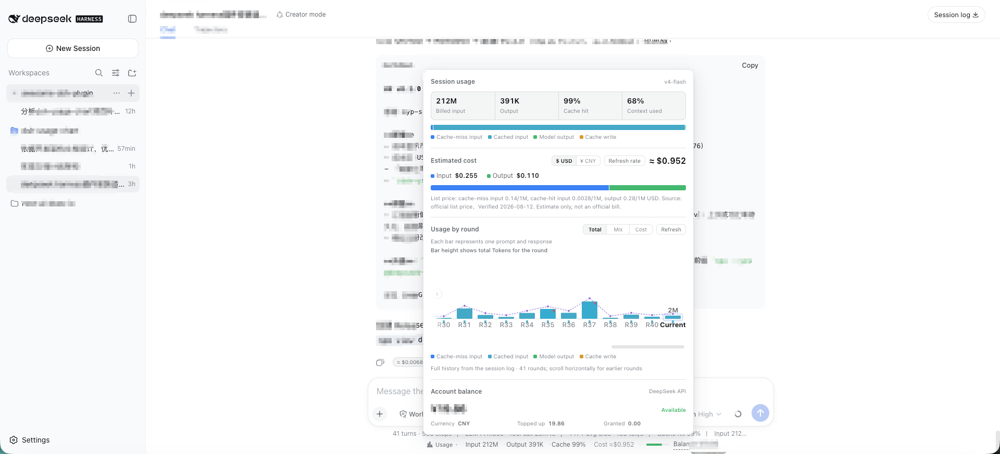
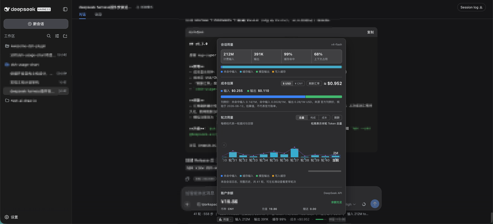

# dsh-usage-chart

> DeepSeek 用量 / 成本 / 余额仪表盘 · DSH Web 插件

[](https://www.npmjs.com/package/dsh-usage-chart)
[](https://github.com/Max-Samson/dsh-usage-chart/actions)
[](./LICENSE)

[English](./README.md) · [问题反馈](https://github.com/Max-Samson/dsh-usage-chart/issues) · [更新日志（中文）](./CHANGELOG_ZH.md) · [Changelog (EN)](./CHANGELOG.md)

界面预览：左侧为浅色英文界面，右侧为深色简体中文界面。两者均会跟随 DSH 的主题与语言设置。

<table>
  <tr>
    <td width="50%"><br /><sub>浅色主题 · English</sub></td>
    <td width="50%"><br /><sub>深色主题 · 简体中文</sub></td>
  </tr>
</table>

> 图片仅使用虚构演示数据：不含真实会话内容、Token、成本、余额或 API Key。

在 DeepSeek Harness Web UI 的**输入框下方**实时显示 token 用量、成本估算、模型与账户余额；点击展开**用量可视化图表面板**（参考 DeepSeek 开发者平台的用量页组织方式），全部使用零依赖 SVG 自绘，不引入任何图表库。成本按官方刊例价（**CNY / USD 双币种，区分高峰/空闲时段**）估算，支持 **USD / CNY 多币种显示**（v0.3 / v1.0.1）。

```
▸ 输入 12.4M · 输出 86.2K · 缓存 72% · 成本 ≈¥0.284 / ≈$0.042 · demo-model · 余额 --
```

点击 ▸ 展开面板：

- **会话用量汇总** — 输入（未命中/命中）、输出、缓存命中率、上下文占用（均来自官方 adapter 上报的 `tokenUsage` / `contextPressure` 投影）
- **上下文构成与压缩诊断（v1.1.0）** — 官方 `contextBreakdown` 投影拆解（系统提示 / 工具定义 / 历史消息 Token 占比与分段条，标注启发式近似）；宿主折叠 `compaction/*` 事件流（哪一轮被压缩、释放了多少 Token、生成摘要花费了多少成本与对应模型）；结合上下文容量占比（≥75% / ≥90%）给出开新会话或精简大文件注入的优化建议
- **成本估算** — 按官方刊例价（CNY/USD 双币种 /1M tokens，高峰/空闲双时段）估算并标注来源与核验日期；支持用户覆盖 `pricing.json`；内置 Anthropic Claude 官方 API 标准价（美元）；未定价模型显式标记「未定价模型」
- **会话成本按轮汇总（v1.1.7）** — 按每轮实际模型和计费时段累加宿主成本；新轮进行中，指示器和面板共用“已读取历史＋新增 token 的估算”，实时用量暂停更新后刷新宿主历史。两处模型名称采用相同的历史/实时来源顺序。
- **DSH 0.1.2+ 与皮肤兼容（v1.1.7）** — 新版从独立 `chat` 源读取会话节点，旧版回退到会话快照；皮肤创建 fixed 定位包含块时，展开面板仍贴近指示器。
- **兼容 DSH 0.2.x client SDK（v1.1.8）** — client peer 范围同时覆盖 DSH 0.1.x 与 0.2.x（已在 0.2.1-rc.2 上验证），DSH 0.2.x 的插件准入校验在启动时即可通过；已移除退役的 `@deepseek-ai/dsh-client-runtime` peer，助手节点模型标识新增读取 0.2.x 的 `providerMetadata` 字段（存在 0.1.x 的 `provenance` 时仍优先，`requestConfig` 保留为最后回退）。
- **高峰/空闲时段计费（v1.0.1）** — 官方高峰时段（北京时间周一至周五 09:00–12:00、14:00–18:00，即 UTC 01:00–04:00、06:00–10:00）价格为空闲时段的 2 倍；其余时段及周末全天为空闲时段；每轮成本按轮次开始时刻自动选用对应时段单价（时刻缺失按高峰保守估算）；面板顶部以**红/绿 tag 实时标注当前计费时段**（红=高峰、绿=空闲），每轮解释卡也显示该轮计费时段
- **双币种官方刊例价（v1.0.1）** — 中文定价页（CNY）与英文定价页（USD）的官方报价同时内置：显式 CNY/USD 报价保留原价；Claude 及用户单币种报价使用同一个展示汇率，刷新同步重算历史与实时估算
- **多币种成本（v0.3 / v1.0.1）** — 成本区 CNY/USD 一键切换（选择在浏览器记住），指示器、面板、图表与成本徽章全部跟随所选币种
- **轮次用量与来源归因（v1.1.0）** — 支持“总量 / 构成 / **成本**”三视角；**成本视角每根柱显示对应费用数值**（逐轮可见，不只在当前轮）；柱顶叠加**总耗时点线**；成本突增轮次加**异常标记**（归因 chip：输出增长 / 上下文膨胀 / 缓存命中下降）；柱底缓存命中迷你刻度；悬浮**解释卡**（token 分桶 + 成本 + 模型 + 计费时段 + 耗时/TTFT/TPS + **输入来源归因：人工/Agent/续跑** + 结束原因）；**全部轮次**横向滚动查看（固定细柱宽 + 自动滚到最新 + 箭头/渐隐提示），从宿主会话日志折叠完整历史，不可用时回退到本页观测增量（同样按快照估算逐轮成本）
- **成本徽章** — 每条助手消息尾部显示可关闭的「本轮 ≈ ¥0.00xx / $0.00xx」徽章（跟随所选币种）
- **分段细上下文压力条（v1.1.0）** — 指示器行内的细压力条（`contextPressure / contextWindow`），消费 `contextBreakdown` 投影分段展示系统（蓝）、工具（橙）、消息（绿）三段占比，随总占用升高由绿转红
- **账户余额** — 官方 `GET /user/balance` 接口实时查询（经宿主侧代理，密钥不暴露给浏览器）
- **中英双语** — 自动跟随 DSH 应用内语言设置，支持运行时切换 `zh` / `en`

## 特性

| 数据 | 来源 | 准确性 |
|---|---|---|
| token 用量 | DSH 官方 adapter 上报的会话投影（`tokenUsage` / `contextPressure`） | ✅ 官方真实数据，实时更新 |
| 成本 | 官方刊例价（内置表 + 可选用户覆盖 `pricing.json`，CNY/USD 双币种 /1M tokens，高峰/空闲双时段）× adapter 上报用量 | ⚠️ 估算值，非官方账单；价格经宿主 `/pricing` 下发；两侧共用来源优先级和换算规则 |
| 成本币种 | 宿主 `/meta` 下发配置；双币种保留原价，单币种按共享展示汇率补全 | ⚠️ 折算为展示估值，非历史账单汇率 |
| 轮次明细 | 宿主会话日志折叠（`/usage`）：耗时 / TTFT / TPS / 模型归因 / **输入来源归因** / 结束原因 / 每轮成本。DSH 0.2.x 累计 `assistant/message` 与失败的 `assistant/attempt` 用量（含仅在 stream 中的样本）；TTFT 取首个携带 token 的片段，TPS 按各次请求生成时长之和计算；0.1.x 保留 chunk/usage 锚点 | ✅ 官方事件流折叠 |
| 上下文与压缩诊断 | 官方 `contextBreakdown` / `contextPressure` 投影 + 宿主 `compaction/*` 事件折叠 | ✅ 官方投影 + 事件流折叠 |
| 余额 | 官方 `GET https://api.deepseek.com/user/balance` | ✅ 官方实时数据 |
| 模型名 | 宿主历史：`request/context` → `request/header` → 最近模型；实时节点：`provenance`（0.1.x）→ `providerMetadata`（0.2.x）→ `requestConfig` | ✅ 官方真实数据 |

## 技术栈

- **语言**：TypeScript 源码，发布为 DSH 可加载的 JavaScript bundle
- **框架**：[Cordis](https://github.com/cordiverse/cordis) 插件模型 + React 18
- **构建**：esbuild（host 半区 = Node ESM；client 半区 = `window.__ModuleLoader__.load({id, factory})` 工厂包，外部依赖与 DSH web 的 `PLATFORM_MODULES` 完全一致）
- **可视化**：零依赖手写 SVG（DSH web 未内置图表库；自绘与平台渲染方式一致、体积最小、最稳定）

## v1.1.9 — Claude 定价与一致的成本估值

**v1.1.9** 包含 Claude 标准价格表、写缓存独立单价、更安全的模型名匹配与未定价轮次处理，并统一宿主／客户端覆盖优先级、补齐成本分项及共享汇率估值。所有单币种报价使用同一个展示汇率；显式双币种原价不变。完整说明见 [v1.1.9 更新日志](./CHANGELOG_ZH.md)。

源码版本不代表 npm 已发布。使用下面的指定版本升级命令前，请先运行 `npm view dsh-usage-chart@1.1.9 version` 确认版本存在。升级后重启 `dsh web` 并刷新浏览器；无需迁移会话数据。

## 安装

前置要求：**[DSH](https://github.com/deepseek-ai/deepseek-harness) ≥ 0.1.0-rc.6** · **Node.js ≥ 20** · PATH 上有 **[pnpm](https://pnpm.io/install)**（`dsh plugin` 会把安装命令转发给 pnpm）。

> 若提示 `dsh: command not found`（或 PowerShell `无法将“dsh”项识别为…`），说明只通过
> `npx @deepseek-ai/dsh` 临时运行过、未安装全局命令——按 [FAQ](#常见问题faq) 第一条解决
> （全局安装后重开终端，或每条 `dsh ...` 前加 `npx --yes @deepseek-ai/dsh`）。

### 方式一：npm 仓库安装（推荐，预构建产物，无需构建工具）

```sh
dsh plugin --profile web add dsh-usage-chart   # 安装并自动登记为 profile 插件层
dsh web --profile web                          # 启动 DSH Web（已在运行时先停止再启动）
```

**v1.1.9 发布后**更新：pnpm 对已安装的依赖重新 `add` 可能显示 `Already up to date`
而不升级，请用**显式版本**（推荐）或**先卸载再安装**：

```sh
# 方式①：显式指定目标版本
dsh plugin --profile web add dsh-usage-chart@1.1.9
# 方式②：先移除再重装（回到最新版）
dsh plugin --profile web remove dsh-usage-chart
dsh plugin --profile web add dsh-usage-chart
```

完成后重启 DSH Web。

> ⚠️ **升级后必须重启 `dsh web` 进程**：宿主在启动时缓存插件代码（无热重载），
> 新路由（如 `/pricing`、`/meta`、`/rate`）只有重启后才生效。详见 [更新日志](./CHANGELOG_ZH.md)。

> ⚠️ **未全局安装 dsh（报 `dsh: command not found` / PowerShell `无法将“dsh”项识别为…`）？
> 把上面每条 `dsh` 都写成 `npx --yes @deepseek-ai/dsh`**，例如
> `npx --yes @deepseek-ai/dsh plugin --profile web add dsh-usage-chart@1.1.9`
> （原因与解法见 [FAQ](#常见问题faq) 第一条）。

### 方式二：从 GitHub 安装（源码构建）

```sh
dsh plugin --profile web add github:Max-Samson/dsh-usage-chart#<commit-sha>
```

Git 安装会执行包的 `prepare` 脚本（`node build.mjs`）从源码构建。pnpm ≥ 10 首次会拒绝运行
`prepare`，需要在 profile 的 `pnpm-workspace.yaml` 中放行：

```yaml
allowBuilds:
  dsh-usage-chart: true
```

> 放行意味着允许该包源码在安装时于本机执行，请只对可信来源这么做，并固定 commit
> （`github:Max-Samson/dsh-usage-chart#<sha>`）。

### 方式三：本地目录安装（开发自测）

```sh
git clone https://github.com/Max-Samson/dsh-usage-chart.git
cd dsh-usage-chart
npm ci && npm run build
dsh plugin --profile web add "$PWD"   # 以链接方式安装当前目录
dsh web --profile web
```

### 验证安装

1. 组合配置中应出现插件行：

   ```sh
   dsh --profile web --dump-config | grep -A4 'id: dsh-usage-chart'
   ```

2. 打开 DSH Web，进入任意已有会话：输入框下方应出现「用量」指示器（含 token/成本/模型），
   右侧为余额；点击 ▸ 展开可视化面板。未配置 API Key 时余额显示 `–`，面板内会提示配置方式。

### 配置余额查询

余额查询需要 DeepSeek API Key，按以下优先级解析（每次请求实时解析，改后无需重启）：

1. **DSH 网页端配置（推荐，需插件 ≥ 0.1.1）**：在 DSH Web 的「设置 → 模型」中配置
   DeepSeek API Key。插件经 DSH 凭据服务读取同一密钥（`.credentials.yaml` 用户层），
   无需额外操作；
2. **环境变量**：启动 `dsh web` 前导出 `DEEPSEEK_API_KEY=sk-...`（凭据服务的 env 层，同样生效）；
3. **插件配置**：在 profile 的 `cordis.patch.yml` 中覆盖（Key 会以明文落盘，仅建议用于受保护的本机 profile）：

```yaml
- insert:
    - id: dsh-usage-chart
      name: dsh-usage-chart
      config:
        apiKey: 'sk-...'        # 留空则回退到网页端/环境变量
        baseUrl: 'https://api.deepseek.com'
        # pricingFile: '/path/to/pricing.json'   # 可选：价格覆盖文件（默认 $DSH_HOME/data/dsh-usage-chart/pricing.json）
        # currency: 'cny'        # 可选（v0.3）：成本显示币种 'usd'（默认）| 'cny'
        # cnyPerUsd: 6.76        # 可选（v0.3）：单币种报价的统一展示汇率（默认 6.76，可「刷新汇率」）
        # fxUrl: 'https://open.er-api.com/v6/latest/USD'   # 可选（v0.3）：自定义实时汇率源
```

> 插件版本 < 0.1.1 时不读取网页端密钥：请用环境变量或上面的 `config.apiKey` 配置。

未配置 Key 时，指示器显示 `余额 –`，点击可重试；面板内会提示如何配置。

### 价格覆盖（可选，v0.2+ / v1.0.1 双币种双时段）

成本按「用户覆盖 > 内置刊例价 > 回退估算」解析（价格只在宿主解析，client 经
`/dsh-usage-chart/pricing` 快照消费，单一价格真相）。默认覆盖文件
`$DSH_HOME/data/dsh-usage-chart/pricing.json`（无 `DSH_HOME` 时 `~/.dsh/...`），
支持两种形状，文件变更即时生效：

```json
{
  "deepseek-flash": {
    "offPeak": {
      "cny": { "cacheMissInput": 1, "cacheHitInput": 0.02, "output": 4 },
      "usd": { "cacheMissInput": 0.15, "cacheHitInput": 0.003, "output": 0.6 }
    },
    "peak": {
      "cny": { "cacheMissInput": 2, "cacheHitInput": 0.04, "output": 8 },
      "usd": { "cacheMissInput": 0.3, "cacheHitInput": 0.006, "output": 1.2 }
    },
    "verifiedAt": 1788998400000
  }
}
```

或 `{ "models": { "<model>": { … } } }`。单价为 **双币种（CNY + USD）/ 1M tokens**：
`peak` 为高峰时段（北京时间周一至周五 09:00–12:00、14:00–18:00，即 UTC 01:00–04:00、06:00–10:00），
`offPeak` 为空闲时段（其余时间及周末全天）。兼容旧格式：平铺
`{ "cacheMissInput": …, "cacheHitInput": …, "output": … }` 视为高峰/空闲同价、
人民币报价（美元按统一展示汇率折算，默认 6.76）。`verifiedAt`（epoch 毫秒）可选，用于面板
展示核验日期。单价可选 `cacheWrite`（写缓存价），缺省按「缓存未命中」价计。

**未收录的模型**会在 UI 中显式标记「未定价模型」：

- DeepSeek 系列（及模型名缺失）按 `deepseek-flash` 刊例价**回退估算**，金额带 `≈`；
- 型号名含 `claude` 的模型（含 Bedrock 写法 `anthropic.claude-…`、`Claude Opus 5.5` 等显示名）
  **不估算**：单价记为 0、成本不计入，避免套用 DeepSeek 价造成数十倍低估。会话合计含此类
  轮次时显示为 `≥`（下限）并在面板提示；成本徽章与压缩成本不显示 `$0`，成本异常检测跳过这些轮次。

#### Claude 系列

内置 [Anthropic 官方价格页](https://platform.claude.com/docs/en/about-claude/pricing) 的标准价
（美元 / 1M tokens，2026-11-05 核验），覆盖 Fable 5.1 / 5、Mythos 5.1 / 5、Opus 5.5 / 5 / 4.8 / 4.7 /
4.6 / 4.5 / 4.1 / 4、Sonnet 5.5 / 5 / 4.6 / 4.5 / 4、Haiku 4.5：

- 不分高峰/空闲；写缓存按 5 分钟 TTL 价计（用量无法区分 1 小时 TTL）；
- 模型名匹配：`anthropic/` 前缀与点号版本（`claude-opus-5.5`）会归一化；带日期快照后缀
  （`-20261101` / `-latest`）的 ID 按对应型号计价；其余变体（未收录的新版本、`-fast`、`-batch`、
  Bedrock 写法等）一律视为未定价，不会被套上相近型号的价格；
- **Claude Haiku 5.5 暂不收录**：其价格按单次请求的输入长度分档（≤100K / >100K），按轮汇总无法判定档位；
- 不计入：批处理折扣、地区 / `inference_geo` 溢价、Fast mode、工具调用费；
- 官方只有美元报价，人民币金额按**统一展示汇率**折算，与所有用户单币种报价共用 `cnyPerUsd`／上次成功值／手动刷新的实时值。

### 币种与汇率（v0.3+ / v1.0.1 官方双币种）

成本区可切换 **CNY/USD**（浏览器记住选择），指示器、面板、图表、压缩成本与消息徽章共用同一展示口径：

- **显式双币种报价**：DeepSeek 官方 CNY/USD 价及用户同时填写的两种报价保留原价，不强制按汇率改写。
- **单币种报价**：内置 Claude（USD）、用户仅提供 `usd` 或 `cny`，以及旧的平铺人民币格式，都由同一个 `pricingAtRate` 函数补全另一币种。写缓存单价也按同一汇率换算。
- **统一汇率来源**：初始采用 `/meta` 下发的 `config.cnyPerUsd`（无效／缺省为 6.76）；有浏览器持久化的上次成功汇率时优先恢复；手动「刷新汇率」经宿主 `/rate` 更新并保存。主源为 `config.fxUrl` 或 open.er-api.com，不可达时回退 frankfurter.dev；失败不覆盖上次成功值。
- **刷新后的历史**：页面把当前汇率作为 `/usage?session=…&cnyPerUsd=…` 的展示参数，宿主重新计算轮次与压缩成本；实时增量和单价说明同步更新。请求按“会话 + 汇率”去重，旧响应不能覆盖新汇率或另一会话。
- **估算而非账单**：历史成本按当前展示汇率重估，不是请求发生时的历史汇率，不修改会话日志。双币种官方报价不随刷新变化。
- **分项完整**：成本分项及比例条展示输入（未命中 + 写缓存）、缓存命中、输出，三者之和等于总额；写缓存有独立单价时在面板说明。

单币种覆盖示例（每 1M tokens，两个时段同价）：

```json
{
  "my-usd-model": {
    "usd": { "cacheMissInput": 4, "cacheHitInput": 0.2, "output": 20, "cacheWrite": 5 }
  }
}
```

价格来源优先级在 host 和 client 完全一致：**用户文件 → 内置表 → 未收录处理**；每个来源内先精确匹配，再选最长有效前缀。因此用户文件的前缀覆盖也优先于内置精确键。

### 卸载

> ⚠️ **未全局安装 dsh（报 `dsh: command not found` / PowerShell `无法将“dsh”项识别为…`）？
> 把下面每条 `dsh` 都写成 `npx --yes @deepseek-ai/dsh`**，例如
> `npx --yes @deepseek-ai/dsh plugin --profile web remove dsh-usage-chart`
> （原因与解法见 [FAQ](#常见问题faq) 第一条）。

```sh
dsh plugin --profile web remove dsh-usage-chart   # 移除依赖并自动从 profile 插件层注销
dsh web --profile web                             # 重启后指示器/面板消失
```

`remove` 会同时清理 `node_modules` 中的包并把它从 `dsh.profile.bundles` 移除（无残留）。
彻底清理（按需）：

- 若曾在 profile 的 `cordis.patch.yml` 中写过 `config.apiKey`/`baseUrl` 覆盖块，删除该段；
- 若为 GitHub 安装加过 `allowBuilds`，可移除 `pnpm-workspace.yaml` 中对应的 `dsh-usage-chart` 条目；
- 网页端配置的 DeepSeek API Key 存于 DSH 凭据文件（`~/.dsh/.credentials.yaml`），
  **不要删除**——DSH 自身的模型服务仍在使用该密钥；只有确定不再使用 DSH 的 DeepSeek 服务时才考虑移除。

## 常见问题（FAQ）

**Q：`dsh` 命令找不到（`command not found` / PowerShell `无法将“dsh”项识别为…`）？**
A：`npx @deepseek-ai/dsh` 是临时运行、不产生全局命令。请 `npm install -g @deepseek-ai/dsh`
并重开终端（Windows 还需确保 `npm config get prefix` 目录在 PATH）；或把每条 `dsh ...`
换成 `npx --yes @deepseek-ai/dsh ...`。pnpm 缺失同理：`npm install -g pnpm`。

**Q：安装时提示 `WARN missing peer react@^18.2.0`？**
A：正常且无害——react 由 DSH Web 平台在浏览器端内置，profile 无需安装。插件 ≥ 0.1.1
已把 react 标记为可选 peer，不再报警；0.1.0 的该警告可忽略。

**Q：DSH 0.2.x 提示 `dsh-usage-chart@1.1.7 与 DSH 0.2.1-rc.2 不兼容（要求 @deepseek-ai/dsh-client-locale >=0.1.0-rc.6 <0.2.0, ...）…`，是插件不兼容吗？**
A：该警告来自 DSH 0.2.x 的**插件准入校验**，不是 DSH 装坏了，也不会丢数据：当插件的 `@deepseek-ai/dsh*` peer 范围不匹配当前运行时版本时 DSH 会拒绝加载，而截至 1.1.7 的插件声明的是仅 0.1.x 的范围。把插件升级到 **≥ 1.1.8**（`dsh plugin --profile web add dsh-usage-chart@1.1.9`）后重启 `dsh web`；若 DSH Web 页面已打开，再刷新页面即可。DSH 本身未受损，会话数据、成本记录与凭据均未丢失——插件只是没有被加载。

**Q：网页端配了 API Key，余额仍显示 `–` 或「未配置」？**
A：请确认插件版本 ≥ 0.1.1（0.1.1 起余额查询才走 DSH 凭据服务读取网页端密钥）；
升级后重启 `dsh web`。临时方案：先设环境变量 `DEEPSEEK_API_KEY` 或 `config.apiKey`。

**Q：`add` 时报 `dsh-usage-chart is not in the npm registry`？**
A：先检查包名、指定版本与 npm registry 的连通性。Git 中的版本不一定已发布到 npm：用 `npm view dsh-usage-chart version` 查看当前发布版本，用 `npm view dsh-usage-chart@<version> version` 检查指定版本。尚未发布的源码可按「方式三：本地目录安装」构建后测试。

## 参与开发

```sh
git clone https://github.com/Max-Samson/dsh-usage-chart.git
cd dsh-usage-chart
npm ci
npm run verify       # typecheck + build + node:test
npm pack --dry-run   # 检查最终发布内容
```

本地自测安装见上文「方式三」；贡献前请阅读 [CONTRIBUTING.md](./CONTRIBUTING.md)，
安全问题请按 [SECURITY.md](./SECURITY.md) 私下报告。

### 可视化验证脚本（可选）

`scripts/` 下有基于 playwright-core 的探测脚本，针对**已运行**的 DSH Web（默认
`http://127.0.0.1:3080`，需要本机 Chrome/Chromium），通过环境变量与你的环境解耦：

| 环境变量 | 默认 | 说明 |
|---|---|---|
| `DSH_PROBE_URL` | `http://127.0.0.1:3080` | 目标 DSH Web 地址 |
| `DSH_PROBE_CHROME` | 平台常见位置 | Chrome/Chromium 可执行文件路径 |
| `DSH_PROBE_SESSION` | 内置常用标题 | 目标会话标题片段（逗号分隔多个备选） |
| `DSH_PROBE_ARTIFACTS` | `<仓库>/artifacts` | 截图输出目录（已 gitignore） |

```sh
node scripts/shot.mjs          # 收起/展开两张截图
node scripts/probe-panel.mjs   # 面板是否被容器裁剪
node scripts/probe-popover.mjs # 悬浮面板边界与开合
node scripts/verify-render.mjs # 完整渲染验证（含明暗主题、中英文界面）
```

## 维护者发布

版本号为 **1.1.9**，内容已定稿。具体 npm 发布时间由维护者决定；源码版本或有日期的更新日志不代表 npm 已发布。两条发布路径**择一执行**，不要并行。

### 手动发布 npm（本次方式）

发布内容当前位于 `fix/pricing-currency-consistency`，尚未合并 `main`。请在你自己的仓库副本、工作区干净的前提下执行：

```sh
git fetch origin
git switch fix/pricing-currency-consistency
git pull --ff-only origin fix/pricing-currency-consistency
git status --short                       # 应无输出
node -p "require('./package.json').version"  # 应为 1.1.9
npm ci
npm run verify
npm pack --dry-run
npm view dsh-usage-chart versions --json   # 确认 1.1.9 尚不存在
# 以下仅由维护者在检查无误后自行执行
npm publish --access public
npm view dsh-usage-chart@1.1.9 version     # 发布后应返回 1.1.9
```

如果工作区／版本不符合预期，或 npm 已存在 1.1.9，应停止，不要自动递增版本或尝试覆盖。`prepublishOnly` 会重跑验证，`prepare` 会重建被忽略的 `lib/`；检查包内运行时入口、类型声明和 README 图片，不要上传旧 tgz，也不要从之前的实现提交发布。npm 登录及可能的 2FA 提示由你直接处理，不要将凭据粘贴到聊天中。

双语日志的版本记录日期为 **2026-11-10（北京时间）**；若实际发布跨日，请在发布前同步调整。各支持版本线的干净 profile 安装结果应单独记录，单元测试或隔离合成宿主浏览器验证不能代替安装验收。用户升级后须重启 `dsh web` 并刷新浏览器；无需迁移会话数据。

### 可选：GitHub Release 自动发布

现有 `release.yml` 在 GitHub Release `published`／`edited` 事件或手动触发 workflow 时，可通过 npm Trusted Publishing 发布。因此本次选择手动 npm 时，**不要先发布 GitHub Release**。不需要为本文改动任何凭据或 publisher 设置。若改走 workflow，应先将 tag 指向最终验证提交并等待 CI，再发布 Release。手动 npm 发布成功后，后续 Release workflow 会跳过 npm 上已存在的版本。仅推送分支或合并代码不会发布 npm。

仓库发现标签继续使用 `dsh-plugin`、`dsh`、`deepseek-harness`。

## 插件结构

```
dsh-usage-chart/
├── package.json          # dsh.bundle（安装层）+ dsh.client（浏览器半区）+ exports["./client"]
├── cordis.patch.yml      # 插件行插入（config.apiKey / baseUrl / pricingFile / currency…）
├── build.mjs             # esbuild 双产物（+ client 纯模块测试束）+ tsc 类型声明（lib/types）
├── src/
│   ├── index.ts          # host 半区：/balance 余额代理 + /usage 轮次折叠 + /pricing 价格快照
│   │                     #          + /meta 币种配置下发 + /rate 实时汇率代理（多源回退）
│   ├── pricing/
│   │   ├── calc.ts       # 纯共享计算（成本分拆/多币种格式化；两个半区 bundle 同一份）
│   │   ├── source.ts     # PricingSource 接缝：builtin 刊例价 + pricing.json 文件适配器
│   │   └── resolve.ts    # PricingResolver：覆盖 > 内置 > 回退，未知模型显式标记
│   ├── usage/
│   │   ├── rounds.ts     # RoundFold：耗时/TTFT/TPS/模型归因/来源归因/结束原因/每轮成本（纯函数）
│   │   └── compactions.ts # CompactionFold：压缩裁剪范围/释放Token/summarize双币种成本（纯函数）
│   └── client/
│       ├── index.ts      # client 入口：注册 composer.dock + assistant-actions 槽位
│       ├── context.ts    # 自包含 slots/locale Context 类型（不再依赖退役 runtime）
│       ├── UsageIndicator.tsx  # 输入框下方一行指示器（含三段着色细压力条）
│       ├── UsagePanel.tsx      # 可视化面板（汇总 / 诊断 / 成本 / 每轮图表 / 余额）编排根
│       ├── charts.tsx          # 零依赖 SVG/HTML 原语（堆叠条/图例）
│       ├── chart/RoundBars.tsx # 深模块柱状图（三视角 + 耗时叠加 + 异常标记 + 来源归因 + 解释卡）
│       ├── rounds/             # observed.ts（本页观测）/ history.ts（宿主历史）/ types.ts
│       ├── diagnose/
│       │   ├── anomaly.ts      # 成本突增判定（图表与徽章共享的纯模块）
│       │   └── context.ts      # ContextReport：上下文构成拆解/压缩统计/优化建议（纯模块）
│       ├── badge/CostBadge.tsx # assistant 消息尾部可关闭成本徽章
│       ├── pricing-api.ts      # usePricing：/pricing 快照消费（client 唯一价格输入）
│       ├── currency.ts         # 币种/汇率 store（/meta 配置 + 切换 + /rate 刷新）
│       ├── balance.ts          # 余额读取 hook（经宿主代理）
│       └── styles.ts           # 注入样式（<style data-plugin>）
└── types/                # 宿主 Cordis 最小类型声明；客户端类型在 src/client/context.ts
```

## 数据与安全边界

- token 与上下文数据来自当前 DSH 会话投影；每轮图表优先读取会话日志，读取失败时会明确标注并回退到本页观测。
- 成本为官方刊例价估算（支持用户覆盖 `pricing.json`）；价格只在宿主解析，client 经 `/pricing` 快照消费，官方价格调整后可通过覆盖文件即时修正。
- 币种与汇率：`/meta` 下发显示配置；`/rate` 经宿主代理拉取汇率（浏览器不直连外部汇率源）；汇率源强制 HTTPS（仅回环放行 HTTP）。
- 余额经宿主同源路由代理（浏览器直连官方 API 有 CORS 与密钥暴露问题）。
- Host 路由只接受同源 GET 请求，并为 JSON 响应设置 `no-store`；插件不会把 API Key 发送到浏览器。
- 自定义 API 地址必须使用 HTTPS；仅回环地址允许 HTTP，便于连接本地代理。

## 兼容性

| 组件 | 支持范围 |
|---|---|
| DSH | 声明的 peer 范围：`>=0.1.0-rc.6 <0.3.0-0`（0.1.x / 0.2.x）。DSH 0.2.x 在声明 `engines.dsh` 时优先按它判断，否则回退到匹配 `@deepseek-ai/dsh*` peer 范围；本插件有意保留 peer 回退，使每个客户端 SDK 包分别受版本门禁约束。`/usage` 优先通过 `snapshotEvents()` 读取事件，保留旧版 `events` 属性回退（`Session.events` 自 `0.1.2-rc.1` 起移除）。验证范围见下文。 |
| Node.js | ≥ 20 |
| Web UI | React 18 / `conversation.composer.dock` + `conversation.chat.assistant-actions` |
| 系统 | macOS、Linux、Windows（纯 JavaScript，无原生依赖） |

v1.1.9 验证范围：Node 20.19.5 / 22.17.0 / 24.22.2 各 **85 项测试通过、0 跳过**，包括发布版本一致性测试；打包及隔离合成宿主浏览器回归通过（配置／实时汇率、保存后重载、CNY/USD、完整成本分项与英文窄屏）。这些都不是实际 DSH／干净 profile 安装验收。历史证据单独保留：v1.1.8 兼容性 PR 作者报告了 DSH 0.2.1-rc.2 链接构建冒烟，Claude PR 作者报告了 0.2.2-rc.1 应用包／接口／日志检查，均不等于当前版本在两条支持线上的干净 profile 安装认证。移除退役 runtime 注入后，仍未重跑 0.1.x 实机安装。

## 社区与开源

- [贡献指南](./CONTRIBUTING.md)
- [行为准则](./CODE_OF_CONDUCT.md)
- [支持渠道](./SUPPORT.md)
- [安全报告](./SECURITY.md)
- [第三方声明](./THIRD_PARTY_NOTICES.md)

## License

MIT
